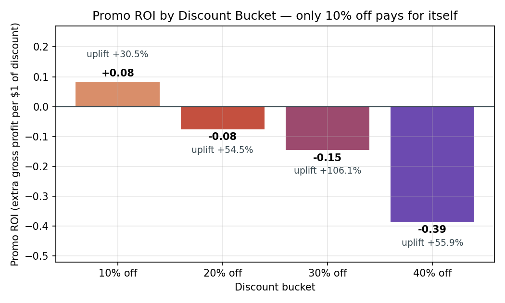
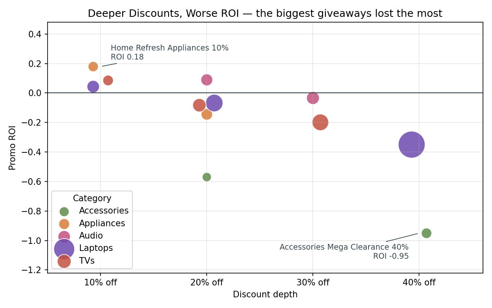
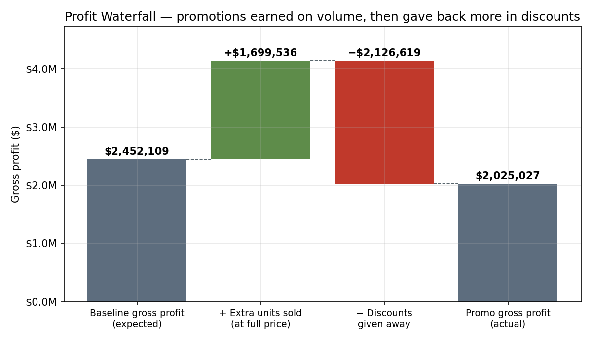
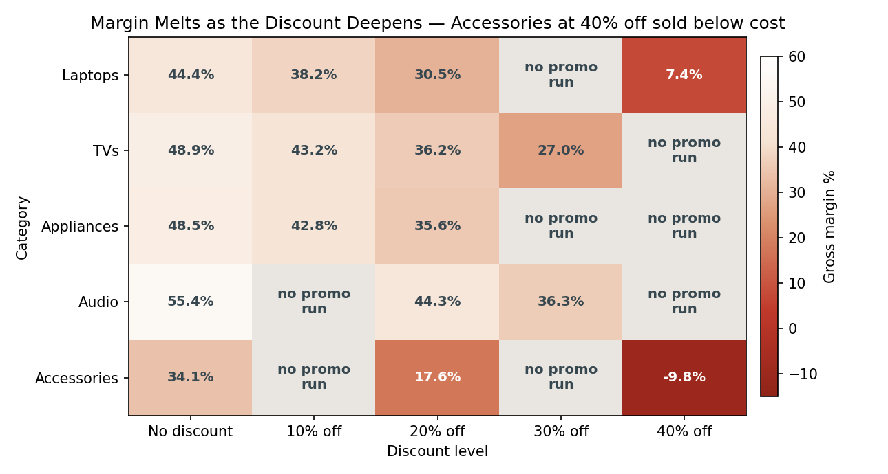
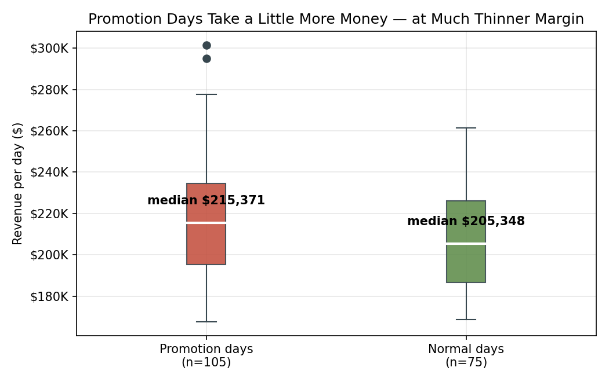
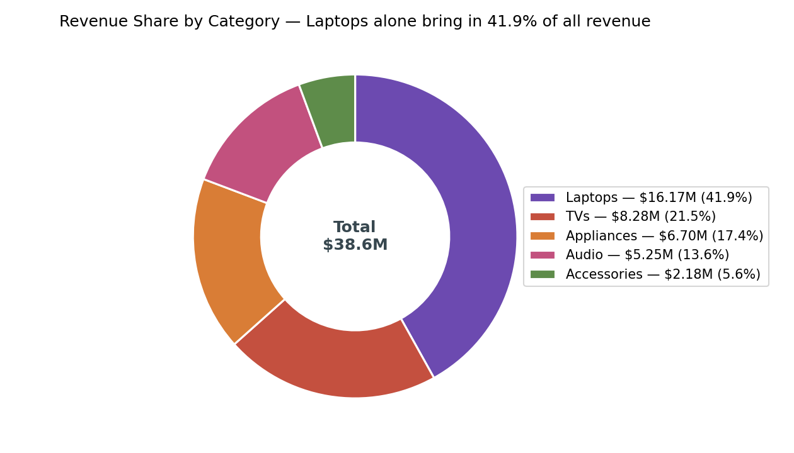
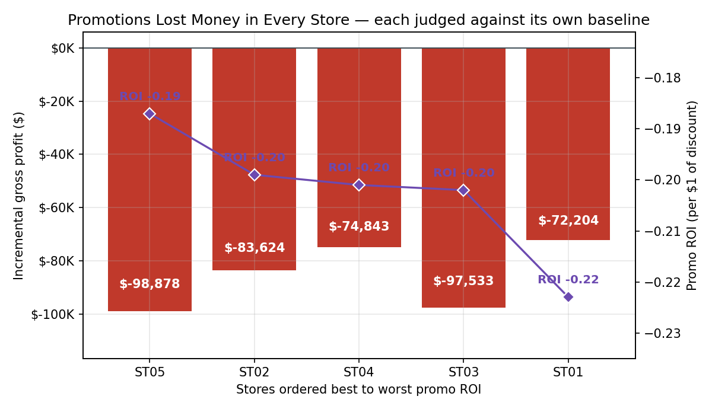
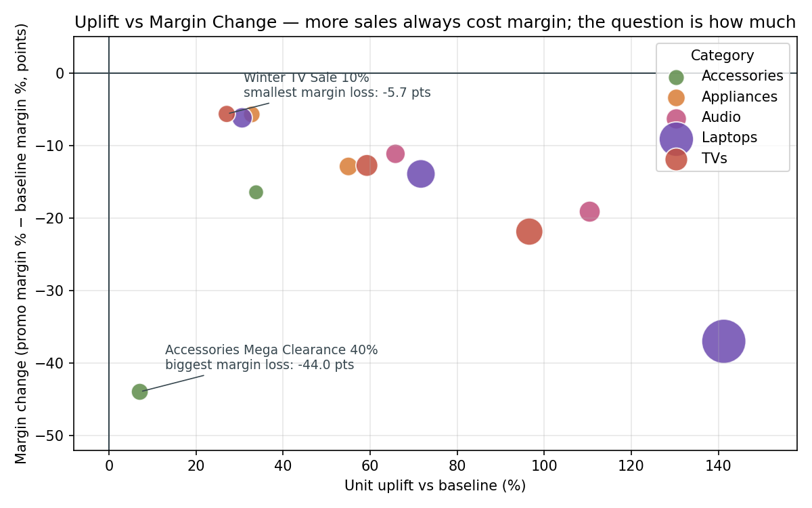
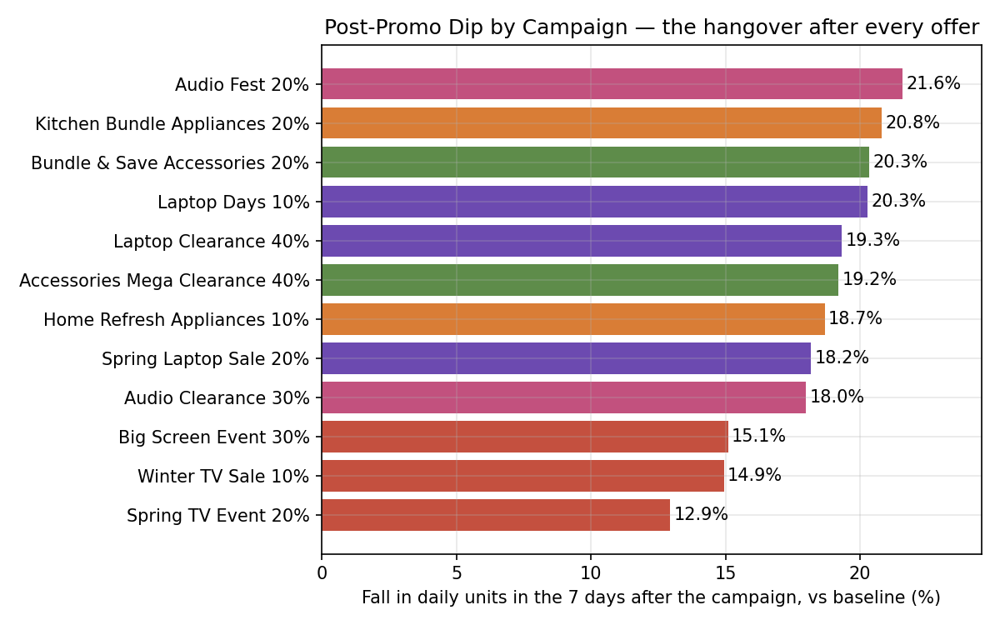
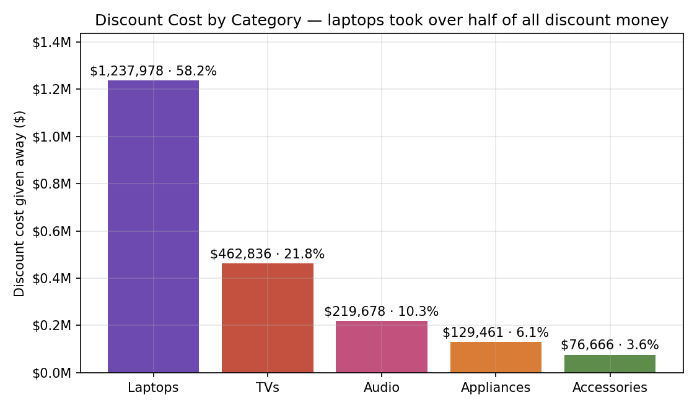

# Promotion Effectiveness and Price Analytics: Discount Depth, Uplift, and Margin Impact

## In simple words — what is this project?

This project is my Best Buy business intelligence analyst job, done as one project.

A shop gives discounts (10% off, 20% off, 40% off) to sell more. But does the shop actually make money, or lose money?
I took shop sales data — 40 products, 5 stores, 180 days, 12 discount offers.
I compared sales on discount days with normal days and checked the real profit.
Main answer: small discounts work, big discounts lose money. Only 10% off made profit.
Sales go up 60% during offers, but profit falls — and after the offer ends, sales drop 18.3% for some days.
Tools used: SQL, Python, Excel, Power BI — the same tools from my 90-day study plan.


     

**The merchandising question every pricing team lives with: how much discount is enough — and how much is just giving margin away?** This project measures, campaign by campaign, what a promotion actually earned: the unit **uplift** it bought over a matched baseline, the **margin** it cost, the **promo ROI** per dollar of discount, and the **post-promo dip** that takes some of the "win" back the following week.

> **Portfolio project — synthetic data only.** Built to mirror the day-to-day work of a retail merchandising / pricing analyst (the Best Buy type of role): pre-promo planning numbers, in-flight tracking, and the post-promo read-out that decides whether a campaign gets repeated, fixed, or killed. It is not paid work experience and contains no real company data.

## The problem

A retailer ran **12 promotions in 180 days** across TVs, Laptops, Audio, Appliances and Accessories, at discounts of 10–40%. Leadership's questions:

1. Which discount depth actually pays for itself — and which just trades margin for volume?
2. Which campaigns should be repeated next season, and which should never run again?
3. How much of each promo spike is new demand, and how much is pulled forward from the following week?

## Project map

Everything a complete project needs, and where it lives:

- [x] **Data** — 3 files, 36,000 rows → [Data](#data) · `data_dictionary.md`
- [x] **Data quality** — checks run, results stated → [Data quality](#data-quality)
- [x] **Method** — the campaign-window method in numbered steps → [Method](#method-and-honest-assumptions)
- [x] **15 headline KPIs** — defined with exact formulas → table below · `KPI_DICTIONARY.md`
- [x] **10 charts** — the gallery under [Dashboard](#dashboard)
- [x] **Interactive dashboard** — working filters, live results → `dashboard/dashboard.html`
- [x] **Findings** — numbered, tied to the KPIs and charts → [Key findings](#key-findings)
- [x] **Recommendations** — what the pricing team should change → [Recommendations](#recommendations)
- [x] **Limitations** — stated honestly, including the synthetic data → [Limitations](#limitations)
- [x] **How to run** — four commands reproduce everything → [How to run](#how-to-run)

## Headline results (from running the code in this repo)

| KPI | Value |
|---|---|
| Total revenue (180 days) | $38,581,528 |
| Average unit uplift on promo | **+60.38%** vs baseline |
| Incremental revenue attributed to promos | +$1,500,802 |
| Incremental gross profit (all campaigns) | **−$427,082** |
| Discount cost given away | $2,126,619 |
| Overall promo ROI | **−0.201** |
| Gross margin — baseline | 45.01% |
| Gross margin — during promotions | 24.11% |
| Average post-promo dip | **18.28%** below baseline |
| Campaigns that made money | **4 of 12** (the other 8 lost money) |
| Best campaign ROI | Home Refresh Appliances 10% — **+0.179** |
| Worst campaign ROI | Accessories Mega Clearance 40% — **−0.951** |
| Best discount bucket ROI | **10% off — +0.084** (the only profitable depth) |
| Worst discount bucket ROI | 40% off — −0.387 |
| Laptops share of discount cost | **58.2%** ($1,237,978 of the money given away) |

📖 **Every KPI above is defined in [KPI_DICTIONARY.md](KPI_DICTIONARY.md)** — what it means in plain words, the exact formula used to calculate it, and which output file it comes from. Supporting detail (per-store results, the profit bridge, per-campaign rows) lives in the breakdown files in `outputs/` — see the dictionary's closing section.

## Dashboard

Open [`dashboard/dashboard.html`](dashboard/dashboard.html) — a single self-contained file (no internet needed) with **working filters**. Pick filters and every number, chart and table row updates:

- **Discount level** — chips: All / Normal days / 10% / 20% / 30% / 40%
- **Category** — dropdown: All + the 5 categories
- **Stores** — multi-select chips: ST01–ST05 (click to include/exclude)
- **Campaign** — dropdown: All + the 12 campaigns

The default view (all filters on "All") reproduces the headline results above exactly. Two kinds of measures sit behind it, labelled in the dashboard footer: daily measures (revenue, units, margin %, discount cost) are re-added from the daily sales rows in scope; campaign measures (uplift, ROI, dip, profitable count) are re-added from the campaign results in scope, using the same campaign-window method — per store when stores are filtered. [`dashboard/dashboard_spec.md`](dashboard/dashboard_spec.md) is the matching Power BI build spec (pages + DAX).


*In simple words: how much extra profit each $1 of discount earned back, grouped by discount depth. Only 10% off is above zero — it earned back $0.08 per $1 given away. Every deeper discount lost money. The small print under each bar shows the extra sales (uplift) that depth bought — more sales, worse profit.*


*In simple words: every dot is one campaign. The deeper the discount (further right), the worse the money result (further down). The size of the dot is the money given away — the biggest dot, the 40% laptop clearance, gave away the most money and still lost money.*


*In simple words: where the money went. The promotion days were expected to earn $2.45M of profit at normal prices. Selling extra units added $1.70M — but the discounts gave away $2.13M, so the shop ended with $2.03M: worse than running no promotions at all.*


*In simple words: the profit margin (money kept from each sale) for each product group at each discount level. Green is healthy, red means sold at a loss. Accessories at 40% off (−9.8%) is the only cell below cost. Empty cells mean that discount was never run for that group.*


*In simple words: how much money comes in on a typical offer day vs a typical normal day. Offer days take a little more money (middle value $215K vs $205K) — but the charts above show that extra money came at much worse profit.*


*In simple words: where the shop's money comes from. Laptops alone bring in 41.9% of all revenue, so what happens in laptop offers decides the whole result.*


*In simple words: the same 12 offers, judged store by store against each store's own normal days. Every store lost money. ST05 lost the most dollars ($98,878) because it is the biggest store, even though its loss per $1 of discount (ROI −0.187) was the least bad; ST01 had the worst rate (ROI −0.223) but the smallest dollar loss.*


*In simple words: every dot is one campaign. Further right = sold a lot more; further down = gave up more profit margin to do it. Every campaign sits below the zero line — more sales always cost margin. The 40% laptop clearance (big purple dot, far right) sold 141% more but gave up 37 points of margin; the accessories mega clearance (bottom left) sold only 7% more and still gave up 44 points.*


*In simple words: after every offer ends, the next week's daily sales fall below normal — shoppers had bought early instead. The biggest hangover is Audio Fest 20% (21.6% below normal); the smallest is Spring TV Event 20% (12.9%).*


*In simple words: where the discount money went. Laptops took $1,237,978 — 58.2% of all the money given away — because laptop prices are high, so each percent off costs more dollars.*

## Key findings

1. **Only shallow discounts pay.** The 10% bucket is the sole depth with positive ROI (+0.084). At 20% the extra volume roughly breaks even on revenue but not on profit; at 30–40% the margin given away grows faster than the volume earned.
2. **The worst campaign is a textbook bad promo.** Accessories Mega Clearance at 40% off produced an uplift of only **+7.1%** at a **−9.83% margin** — sold below cost, revenue *fell* $45,864 vs baseline, and it returned **−$0.95 of gross profit per $1 of discount**. Low-elasticity categories must never be deep-discounted.
3. **Uplift is partly borrowed.** Sales dip **18.28% below baseline** in the week after a campaign ends (pull-forward). Judged on promo week + dip week together, several "winning" campaigns get much weaker.
4. **Revenue lies, profit doesn't.** Promotions added +$1.5M of incremental revenue yet destroyed $427K of gross profit overall, as margin compressed from 45.01% to 24.11%.
5. **The profit bridge tells the whole story in one picture.** Across all promo windows, the campaigns were expected to earn $2,452,109 of gross profit at normal rates. The extra units sold added $1,699,536 of gross profit at full price — then the discounts gave away $2,126,619. Final promo gross profit: $2,025,027, which is exactly the −$427,082 incremental result above. The volume worked; the price cuts cost more than the volume earned.
6. **Only 4 of 12 campaigns made money.** Every profitable campaign sits at 10–20% off in the scatter chart; every campaign at 30–40% off lost money, and the biggest bubbles (most discount money given away) sit deepest in the red.
7. **Margin melts cell by cell.** The category × discount heatmap runs from Audio at full price (55.44% margin) down to Accessories at 40% off (−9.83% — sold below cost). No category survives a 40% cut with its margin intact: even Laptops fall from 44.42% to 7.39%.
8. **Busy days are only slightly richer days.** Median daily revenue is $215,371 on the 105 promotion days vs $205,348 on the 75 normal days — about 5% more money through the till, bought with $2.13M of discounts.
9. **Promotions lost money in every store.** Judged store by store (each store against its own baseline), all five stores returned a negative promo ROI — no strong store carried the chain. The ranking flips with the measure: ST05 has the least-bad ROI (−0.187) but the biggest dollar loss (−$98,878), because it gave away the most discount money ($527,967); ST01 has the worst ROI (−0.223) but the smallest dollar loss (−$72,204). (Per-store detail: `outputs/promo_by_store.csv`.)
10. **Every campaign bought volume with margin — the only question was the exchange rate.** In the uplift-vs-margin-change scatter, all 12 campaigns sit below zero on margin change. The cheapest volume was Winter TV Sale 10% (+27.1% uplift for −5.7 points of margin); the most expensive was Accessories Mega Clearance 40% (+7.1% uplift for −44.0 points of margin).
11. **Discount money concentrates in laptops.** Laptops absorbed $1,237,978 of the $2,126,619 given away (58.2%), so laptop discount policy alone decides whether the chain's promotions make or lose money.

## Recommendations

1. **Cap general discounts at 10–20%.** 10% off is the only depth that paid for itself (+0.084 per $1); 20% is the ceiling for traffic events, not a default.
2. **Stop 40% clearances** — except for genuine end-of-life stock that must clear, and judge those on cash freed and shelf space, not on ROI. The 40% bucket lost $0.39 per $1 given away.
3. **Fix Laptops discount discipline first.** Laptops take 58.2% of all discount money; any laptop offer above 10% should need sign-off with an elasticity estimate attached.
4. **Never deep-discount low-response categories.** Accessories barely respond to price cuts (+7.1% uplift at 40% off) — depth must be matched to how strongly each category responds.
5. **Judge every campaign on promo week + dip week together**, and measure the halo effect (deal shoppers buying full-price items) with basket data before deciding anything bigger.

## Method (and honest assumptions)

The campaign-window method, in plain steps:

1. **Build the baseline.** For each campaign, take the 28 days immediately before it, same category, using only *clean* days (no promotion running, not in a dip week) — so baselines are not contaminated by other campaigns or pull-forward.
2. **Measure the promo window.** The campaign's own start-to-end dates, same category.
3. **Turn windows into daily rates.** Divide by exposure (SKU-store-days), so campaigns of different lengths and category sizes compare fairly — rates, not totals.
4. **Compute the campaign measures.** Uplift (promo daily units vs baseline), incremental revenue and gross profit (actual minus what the same exposure would have done at baseline rates), discount cost (units × full price × discount %), and **promo ROI = incremental gross profit ÷ discount cost**. ROI > 0 means the discount paid for itself.
5. **Measure the dip.** Compare the 7 days after the campaign ends with the baseline daily rate — the post-promo dip %.
6. **Roll up and cross-check.** Campaigns group into discount buckets (money summed; uplift and margins weighted by units sold on promotion); the same method runs inside each store separately (`outputs/promo_by_store.csv`), each store against *its own* baselines; the profit bridge (`outputs/profit_bridge.csv`) reconciles the whole programme. The five store results sum back to the chain totals (incremental gross profit exactly; discount cost within a cent of rounding), which cross-checks the split.

**One exception to step 1:** the first two campaigns start on 13 and 27 January, before 28 days of data exist, so all the clean days available were used (12 days for the first campaign, 19 for the second).

**Assumptions to state out loud in an interview:** cross-category cannibalisation is *not* modelled; the dip captures only within-category pull-forward over 7 days; there is no halo effect (promo visitors buying full-price items), which in real retail offsets part of the loss; competitor pricing and seasonality are not controlled for. The generator plants known effects (per-category elasticity, an 80% dip week, one low-elasticity 40% clearance) so results can be checked against ground truth.

## Data

| File | Rows | Key columns |
|---|---|---|
| `data/products.csv` | 40 SKUs | `sku_id`, `product_name`, `category` (Laptops / TVs / Appliances / Audio / Accessories), `base_price`, `unit_cost` |
| `data/promotions.csv` | 12 campaigns | `promo_id` (P01–P12), `campaign_name`, `scope_value` (category), `start_date`, `end_date`, `discount_pct` (10/20/30/40), `promo_type` |
| `data/sales.csv` | 36,000 SKU-store-days | `date` (180 days), `sku_id`, `store_id` (ST01–ST05), `units`, `revenue`, `discount_pct_applied`, `promo_id` (blank on normal days) |

Full column-by-column definitions: [`data_dictionary.md`](data_dictionary.md).

## Data quality

Checks run by `tests/test_kpis.py` (all passing) and by the analysis itself:

- **Grid is complete:** exactly 36,000 rows = 180 days × 40 SKUs × 5 stores — no missing or duplicated SKU-store-days.
- **Revenue arithmetic holds:** sampled rows satisfy revenue = units × base price × (1 − discount %).
- **Promo consistency:** every promotion row carries a campaign ID and a discount above 0; every non-promo row has discount 0 and no campaign ID.
- **Sane ranges:** no negative units or revenue; discount levels are only 0/10/20/30/40.
- **Totals recomputed from raw data:** the tests rebuild headline totals (e.g. total revenue, total units 102,737) straight from `data/sales.csv` and compare — PASS.

## Limitations

- **Synthetic data.** Generated by a seeded script with planted effects (per-category elasticity, an 80%-of-baseline dip week, one deliberately bad clearance). The method is the work sample; the magnitudes are not real-world measurements.
- **No control group.** The baseline assumes the 28 pre-promo clean days represent "what would have happened anyway" — seasonality or a trend inside the window is not controlled. Control stores + difference-in-differences is the fix.
- **No cross-category cannibalisation, no halo effect.** A TV deal stealing laptop sales, and deal shoppers also buying full-price items, are both unmodelled; the halo would offset part of the loss in real retail.
- **Dip measured for 7 days, same category only.** Longer pull-forward is not captured.
- **Gross profit only.** Rent, wages and other operating costs are outside the data; vendor funding (manufacturers co-funding discounts in real retail) is not modelled either.

## Repository structure

```
├── README.md / LEARN.md       <- overview / learn-from-scratch path with drills & answers
├── generate_data.py           <- seeded synthetic data (products / promotions / sales)
├── analysis.py                <- baseline matching, uplift, ROI, dip -> outputs/
├── charts.py                  <- the 10 charts in images/
├── KPI_DICTIONARY.md          <- the 15 headline KPIs in plain words: meaning, exact formula, source
├── requirements.txt
├── data/                      <- products, promotions, sales (36,000 rows)
├── outputs/                   <- kpi_summary (15 headline KPIs), campaign_performance, uplift_by_discount_bucket,
│                                 promo_by_store, profit_bridge, margin_by_category_discount, insights.md
├── images/                    <- 10 chart PNGs embedded above
├── sql/analysis_queries.sql   <- 10 commented queries (baseline, uplift, dip, ranking)
├── dashboard/                 <- dashboard.html (interactive, working filters) + build_data.py (rebuilds it)
│                                 + dashboard_spec.md (Power BI + DAX)
├── notebooks/analysis.ipynb   <- walkthrough reproducing the headline KPIs
├── data_dictionary.md / tests/test_kpis.py / LICENSE
```

## How to run

```bash
pip install -r requirements.txt
python3 generate_data.py     # creates data/*.csv (seeded, reproducible)
python3 analysis.py          # creates outputs/*.csv and outputs/insights.md
python3 charts.py            # creates images/*.png
python3 tests/test_kpis.py   # PASS - margins, uplift, ROI and totals all checked
```

## SQL highlights

`sql/analysis_queries.sql` mirrors the Python logic in 10 commented queries: margin by bucket, campaign scorecard, the 28-day clean-baseline CTE, uplift, the dip calculation, ranking with `RANK()`, a rolling average with `LAG()`, and a "bad promo detector" (negative margin, or ≥30% off with margin < 10%).

## 60-second talk track

"I analysed 12 retail promotions over 180 days — 40 SKUs, 5 stores, 36,000 SKU-store-days of sales. For each campaign I built a matched baseline from the 28 clean days before it (fewer for the two January campaigns, where the data does not reach back that far), then measured three things: unit uplift, margin impact, and promo ROI — incremental gross profit per dollar of discount. The headline: promotions lifted units 60% on average and added $1.5M of revenue, but overall they destroyed about $427K of gross profit. Only the 10% discount bucket paid for itself. The worst campaign, a 40% accessories clearance, is the one I'd teach a junior analyst with: uplift of only 7%, sold below cost, ROI of minus 0.95 — deep-discounting a low-elasticity category. And because sales dip 18% the week after a promo, I judge every campaign on promo week plus dip week combined. My recommendation to the pricing team: cap general discounts at 10–20%, reserve 30%+ for genuine clearance of overstock, and never deep-discount accessories."

## Interview Q&A

**Q1. How do you measure whether a promotion worked?**
Against a baseline, never against last week alone. I use the 28 clean days before the campaign for the same category (all the clean days there are for the first two campaigns, which start in January), compare daily units per SKU-store-day (uplift %), then convert to money: incremental revenue, incremental gross profit, and ROI per dollar of discount cost.

**Q2. A promo doubled unit sales. Was it a success?**
Not necessarily — check margin and ROI. One 30% campaign here more than doubled units yet still lost gross profit: every unit sold at a much thinner margin. Volume is vanity; incremental gross profit is the verdict.

**Q3. What is the post-promo dip and why does it matter?**
Customers pull purchases forward into the promo week, so the following week drops — here 18.28% below baseline on average. If you ignore it, you overstate uplift and repeat campaigns that mostly reschedule demand instead of creating it.

**Q4. Why did the 40% accessories clearance fail so badly?**
Accessories have low price elasticity in this data: a 40% price cut bought only 7.1% more units, while the price fell below unit cost (margin −9.83%). Discount depth must be matched to elasticity — deep cuts only make sense where volume responds strongly or the stock must genuinely clear.

**Q5. What are the limitations of this analysis?**
No cross-category cannibalisation, no halo effect, no competitor or seasonality controls, and the baseline assumes the 28 pre-promo days represent 'normal' demand. I state all of that unprompted — and explain how I'd test each with richer data (control stores, basket-level transactions, a longer pre-period).

## Next steps

Control-store difference-in-differences, basket-level halo measurement, vendor-funding offsets, and a per-category price-elasticity curve to *set* the optimal discount depth instead of testing buckets after the fact.

---
*Synthetic data generated with a fixed seed for education and portfolio use. MIT License.*
