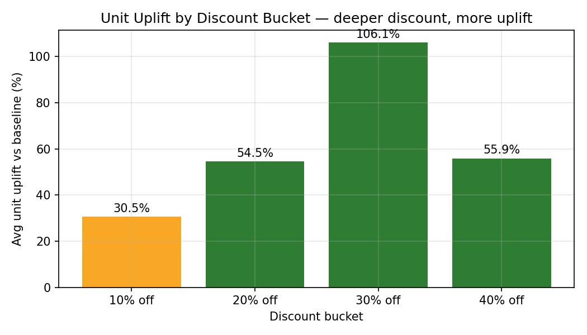
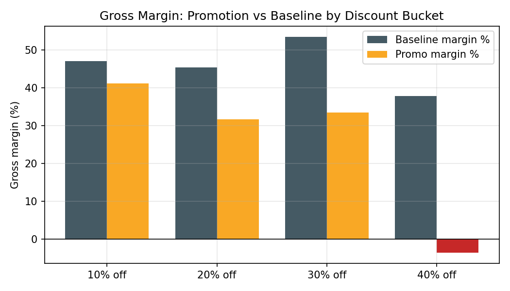
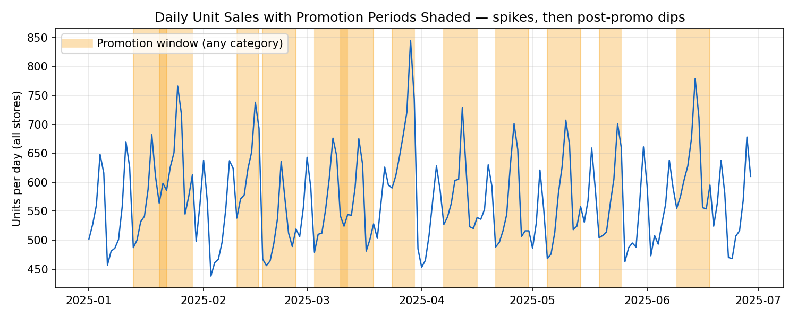
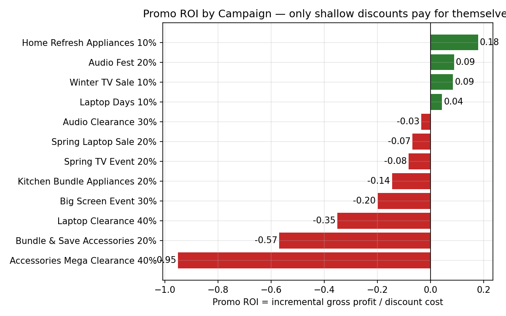

# Promotion Effectiveness and Price Analytics: Discount Depth, Uplift, and Margin Impact

## In simple words — what is this project?

This project is my Best Buy business intelligence analyst job, done as one project.

A shop gives discounts (10% off, 20% off, 40% off) to sell more. But does the shop actually make money, or lose money?
I took shop sales data — 40 products, 5 stores, 180 days, 12 discount offers.
I compared sales on discount days with normal days and checked the real profit.
Main answer: small discounts work, big discounts lose money. Only 10% off made profit.
Sales go up 60% during offers, but profit falls — and after the offer ends, sales drop 18.3% for some days.
Tools used: SQL, Python, Excel, Power BI — the same tools from my 90-day study plan.

     

**The merchandising question every pricing team lives with: how much discount is enough — and how much is just giving margin away?** This project measures, campaign by campaign, what a promotion actually earned: the unit **uplift** it bought over a matched baseline, the **margin** it cost, the **promo ROI** per dollar of discount, and the **post-promo dip** that takes some of the "win" back the following week.

> **Portfolio project — synthetic data only.** Built to mirror the day-to-day work of a retail merchandising / pricing analyst (the Best Buy type of role): pre-promo planning numbers, in-flight tracking, and the post-promo read-out that decides whether a campaign gets repeated, fixed, or killed. It is not paid work experience and contains no real company data.

## Business problem

A retailer ran **12 promotions in 180 days** across TVs, Laptops, Audio, Appliances and Accessories, at discounts of 10–40%. Leadership's questions:

1. Which discount depth actually pays for itself — and which just trades margin for volume?
2. Which campaigns should be repeated next season, and which should never run again?
3. How much of each promo spike is new demand, and how much is pulled forward from the following week?

## Headline results (from running the code in this repo)

| KPI | Value |
|---|---|
| Total revenue (180 days) | $38,581,528 |
| Total units sold | 102,737 |
| Campaigns analysed | 12 |
| Average unit uplift on promo | **+60.38%** vs baseline |
| Incremental revenue attributed to promos | +$1,500,802 |
| Discount cost given away | $2,126,619 |
| Incremental gross profit (all campaigns) | **−$427,082** |
| Overall promo ROI | **−0.201** |
| Gross margin — baseline vs promo | 45.01% → 24.11% |
| Average post-promo dip | **18.28%** below baseline |
| Best discount bucket | **10% off — ROI +0.084** (the only profitable depth) |
| Worst discount bucket | 40% off — ROI −0.387 |
| Best campaign | Home Refresh Appliances 10% — ROI +0.179 |
| Worst campaign | **Accessories Mega Clearance 40% — ROI −0.951** |

## Dashboard






## Key insights

- **Only shallow discounts pay.** The 10% bucket is the sole depth with positive ROI (+0.084). At 20% the extra volume roughly breaks even on revenue but not on profit; at 30–40% the margin given away grows faster than the volume earned.
- **The worst campaign is a textbook bad promo.** Accessories Mega Clearance at 40% off produced an uplift of only **+7.1%** at a **−9.83% margin** — sold below cost, revenue *fell* $45,864 vs baseline, and it returned **−$0.95 of gross profit per $1 of discount**. Low-elasticity categories must never be deep-discounted.
- **Uplift is partly borrowed.** Sales dip **18.28% below baseline** in the week after a campaign ends (pull-forward). Judged on promo week + dip week together, several "winning" campaigns get much weaker.
- **Revenue lies, profit doesn't.** Promotions added +$1.5M of incremental revenue yet destroyed $427K of gross profit overall, as margin compressed from 45.01% to 24.11%.

## Method (and honest assumptions)

- **Baseline:** the 28 days immediately before each campaign, same category, using only *clean* days (no promotion, not in a dip week) — so baselines are not contaminated by other campaigns or pull-forward.
- **Rates, not totals:** uplift compares daily units **per SKU-store-day**, so campaigns of different lengths and scopes are comparable.
- **Promo ROI** = incremental gross profit ÷ discount cost; incremental gross profit = actual promo GP − the GP the same exposure would have earned at baseline rate. ROI > 0 means the discount paid for itself.
- **Assumptions to state out loud in an interview:** cross-category cannibalisation is *not* modelled; the dip captures only within-category pull-forward over 7 days; there is no halo effect (promo visitors buying full-price items), which in real retail offsets part of the loss; competitor pricing and seasonality are not controlled for. The generator plants known effects (per-category elasticity, an 80% dip week, one low-elasticity 40% clearance) so results can be checked against ground truth.

## Data files (all in `data/`)
- `products.csv` — 40 products: category, full selling price, unit cost
- `promotions.csv` — 12 campaigns: category, start and end dates, discount % (10, 20, 30 or 40)
- `sales.csv` — 36,000 rows — one row per product, per store, per day: units sold, revenue, discount applied

How the headline numbers are calculated: Uplift = extra daily sales during a promotion vs normal days · Promo ROI = extra profit made ÷ money given away in discounts · Post-promo dip = how much daily sales fall in the 7 days after a campaign ends.

## Repository structure

```
├── analysis.py                <- baseline matching, uplift, ROI, dip -> outputs/
├── charts.py                  <- the 4 charts in images/
├── requirements.txt
├── data/                      <- products, promotions, sales (36,000 rows)
├── outputs/                   <- kpi_summary, campaign_performance, uplift_by_discount_bucket
├── images/                    <- 4 chart PNGs embedded above
├── sql/analysis_queries.sql   <- 10 commented queries (baseline, uplift, dip, ranking)
```

## How to run

```bash
pip install -r requirements.txt
python3 analysis.py          # creates outputs/*.csv and outputs/insights.md
python3 charts.py            # creates images/*.png
```

## SQL highlights

`sql/analysis_queries.sql` mirrors the Python logic in 10 commented queries: margin by bucket, campaign scorecard, the 28-day clean-baseline CTE, uplift, the dip calculation, ranking with `RANK()`, a rolling average with `LAG()`, and a "bad promo detector" (negative margin, or ≥30% off with margin < 10%).

## 60-second talk track

"I analysed 12 retail promotions over 180 days — 40 SKUs, 5 stores, 36,000 SKU-store-days of sales. For each campaign I built a matched baseline from the 28 clean days before it, then measured three things: unit uplift, margin impact, and promo ROI — incremental gross profit per dollar of discount. The headline: promotions lifted units 60% on average and added $1.5M of revenue, but overall they destroyed about $427K of gross profit. Only the 10% discount bucket paid for itself. The worst campaign, a 40% accessories clearance, is the one I'd teach a junior analyst with: uplift of only 7%, sold below cost, ROI of minus 0.95 — deep-discounting a low-elasticity category. And because sales dip 18% the week after a promo, I judge every campaign on promo week plus dip week combined. My recommendation to the pricing team: cap general discounts at 10–20%, reserve 30%+ for genuine clearance of overstock, and never deep-discount accessories."

## Interview Q&A

**Q1. How do you measure whether a promotion worked?**
Against a baseline, never against last week alone. I use the 28 clean days before the campaign for the same category, compare daily units per SKU-store-day (uplift %), then convert to money: incremental revenue, incremental gross profit, and ROI per dollar of discount cost.

**Q2. A promo doubled unit sales. Was it a success?**
Not necessarily — check margin and ROI. One 30% campaign here more than doubled units yet still lost gross profit: every unit sold at a much thinner margin. Volume is vanity; incremental gross profit is the verdict.

**Q3. What is the post-promo dip and why does it matter?**
Customers pull purchases forward into the promo week, so the following week drops — here 18.28% below baseline on average. If you ignore it, you overstate uplift and repeat campaigns that mostly reschedule demand instead of creating it.

**Q4. Why did the 40% accessories clearance fail so badly?**
Accessories have low price elasticity in this data: a 40% price cut bought only 7.1% more units, while the price fell below unit cost (margin −9.83%). Discount depth must be matched to elasticity — deep cuts only make sense where volume responds strongly or the stock must genuinely clear.

**Q5. What are the limitations of this analysis?**
No cross-category cannibalisation, no halo effect, no competitor or seasonality controls, and the baseline assumes the 28 pre-promo days represent 'normal' demand. I state all of that unprompted — and explain how I'd test each with richer data (control stores, basket-level transactions, a longer pre-period).

## Next steps

Control-store difference-in-differences, basket-level halo measurement, vendor-funding offsets, and a per-category price-elasticity curve to *set* the optimal discount depth instead of testing buckets after the fact.

---
*Synthetic data generated with a fixed seed for education and portfolio use. MIT License.*
